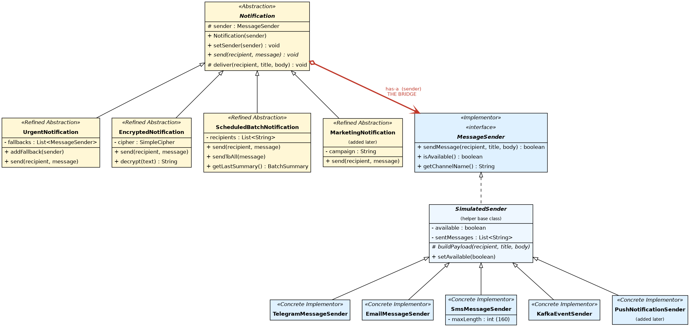

# Multi-Channel Notification Gateway (Bridge pattern)

Assignment 3 for Software Design Patterns. Java 17+, Maven, JUnit 5.

The gateway sends notifications of different kinds (urgent, encrypted, batch,
marketing) through different providers (Telegram, Email, SMS, Kafka, Push).
All providers are simulated, nothing talks to a real API, messages are printed
to the console and kept in a small in-memory "outbox" so tests can look at them.

## How to run

```
mvn test                              # 31 unit tests
mvn compile
java -cp target/classes gateway.Main  # runs the 6 demo scenarios
```

## Project structure

```
src/main/java/gateway
  Main.java                       demo of all scenarios
  sender/                         Implementor side
    MessageSender.java            the Implementor interface
    SimulatedSender.java          small helper base (availability + outbox)
    TelegramMessageSender.java
    EmailMessageSender.java
    SmsMessageSender.java
    KafkaEventSender.java
    PushNotificationSender.java   added later
  notification/                   Abstraction side
    Notification.java             the Abstraction
    UrgentNotification.java
    EncryptedNotification.java
    ScheduledBatchNotification.java
    MarketingNotification.java    added later
    BatchSummary.java, DeliveryFailedException.java
  crypto/SimpleCipher.java        XOR + Base64 (not real crypto)
src/test/java/gateway             JUnit 5 tests
docs/uml-class-diagram.png        UML (the .dot file is the source)
```

## What each part does

**Senders** (all behave differently):

- Telegram puts the title in bold (markdown) above the text.
- Email builds a message with `To`, `Subject`, the body and a signature. The recipient must contain `@`.
- SMS sends only if the whole text is at most 160 characters (the limit is a constructor parameter, so `new SmsMessageSender(120)` works). The recipient must look like a phone number.
- Kafka does not send text, it publishes an event (topic, key, offset, JSON value). The offset goes up with every event.
- Push shows a short banner, a body longer than 120 characters is cut with `...`.

**Notifications**:

- `UrgentNotification` adds `[URGENT] `, checks `isAvailable()` and walks through the primary sender and then the fallbacks. It also moves on if a sender is available but refuses the message. If nobody can deliver it throws `DeliveryFailedException`.
- `EncryptedNotification` encrypts the text (XOR + Base64) before it goes to the sender.
- `ScheduledBatchNotification` sends to a list of recipients and keeps a summary (`Total / Successful / Failed`). The "scheduled" part is only simulated: the batch is sent when `send` is called, a real scheduler would call it at the right time.
- `MarketingNotification` adds a campaign tag and an unsubscribe line.

## Demo

`Main` shows the six required scenarios:

1. UrgentNotification + Telegram
2. EncryptedNotification + Email
3. ScheduledBatchNotification + SMS (10 recipients, 8 ok, 2 failed)
4. Runtime switching Telegram -> Email on the same object
5. Telegram unavailable, fallback to SMS
6. MarketingNotification + PushNotificationSender

There is no class like `UrgentTelegramNotification` anywhere. Any notification can be combined with any sender when the object is created.

## Tests

31 tests in 7 classes. They cover successful delivery, unavailable provider, fallback
(also with a fake sender that is not part of the project, to show only the interface matters),
SMS length (160 and 120), encrypted message and decrypting it back, batch summary, runtime
switching, the new Push sender, the new Marketing notification and several failure cases
(everything down, provider unavailable, bad recipient, empty batch, null sender).

## Answers to the questions

**What are the two independent dimensions?**
The first is the kind of notification (urgent, encrypted, batch, marketing): what we do with the message.
The second is the delivery provider (Telegram, Email, SMS, Kafka, Push): how the message actually gets out.

**Where exactly is the Bridge?**
In the field `protected MessageSender sender` in `Notification`. This reference from the
abstraction hierarchy to the implementor hierarchy is the bridge. Notifications call only
`sendMessage`, `isAvailable` and `getChannelName`, they never know the concrete class.

**Why is inheritance problematic here?**
With inheritance every combination needs its own class: `UrgentTelegramNotification`,
`UrgentEmailNotification`, `EncryptedSmsNotification` and so on. With 4 types and 5 providers that
is 20 classes, and each new provider or type adds a whole row or column. The same logic (the
`[URGENT]` prefix, the fallback, the encryption) would be copied in every provider variant.
Also a provider could not be changed at runtime, because the class is already fixed.

**What happens when a new provider is added?**
I write one class that implements `MessageSender` (here `PushNotificationSender`). No
notification class changes. The git commit for it contains only that new class and its test.

**What happens when a new Notification type is added?**
I write one class that extends `Notification` (here `MarketingNotification`). No sender
changes, and it works with all five providers right away. The commit touches only the new
class, its test and `Main` (to add the demo scenario, which is client code).

**Why is this Bridge and not Adapter?**
Adapter is used after the fact, when two interfaces already exist and do not match, and we
wrap one to look like the other. Here I designed both sides myself, on purpose, so that they
can change separately: the abstraction and the implementation are split before anything is
written. Also the notification does not convert one interface into another, it just
delegates the delivery part to whatever sender it holds.

## Why the extension shows the main advantage of Bridge

After the first version was finished I added `PushNotificationSender` and
`MarketingNotification` in two separate commits (see `git log`). The push sender worked with
Urgent, Encrypted and Batch notifications immediately, and the marketing notification
worked with Telegram, Email, SMS, Kafka and Push immediately, and in neither commit was an
existing notification or sender class edited. Both hierarchies grew on their own, which is
exactly the point of Bridge: abstraction and implementation evolve independently, and the
number of classes grows as N + M and not as N x M.

## UML



Roles: `Notification` is the Abstraction, the four notification classes are Refined
Abstractions, `MessageSender` is the Implementor, the five senders are Concrete
Implementors, and the red `has-a` arrow is the Bridge. `SimulatedSender` is only a helper
base class for the fake providers, it is not a part of the pattern itself.
